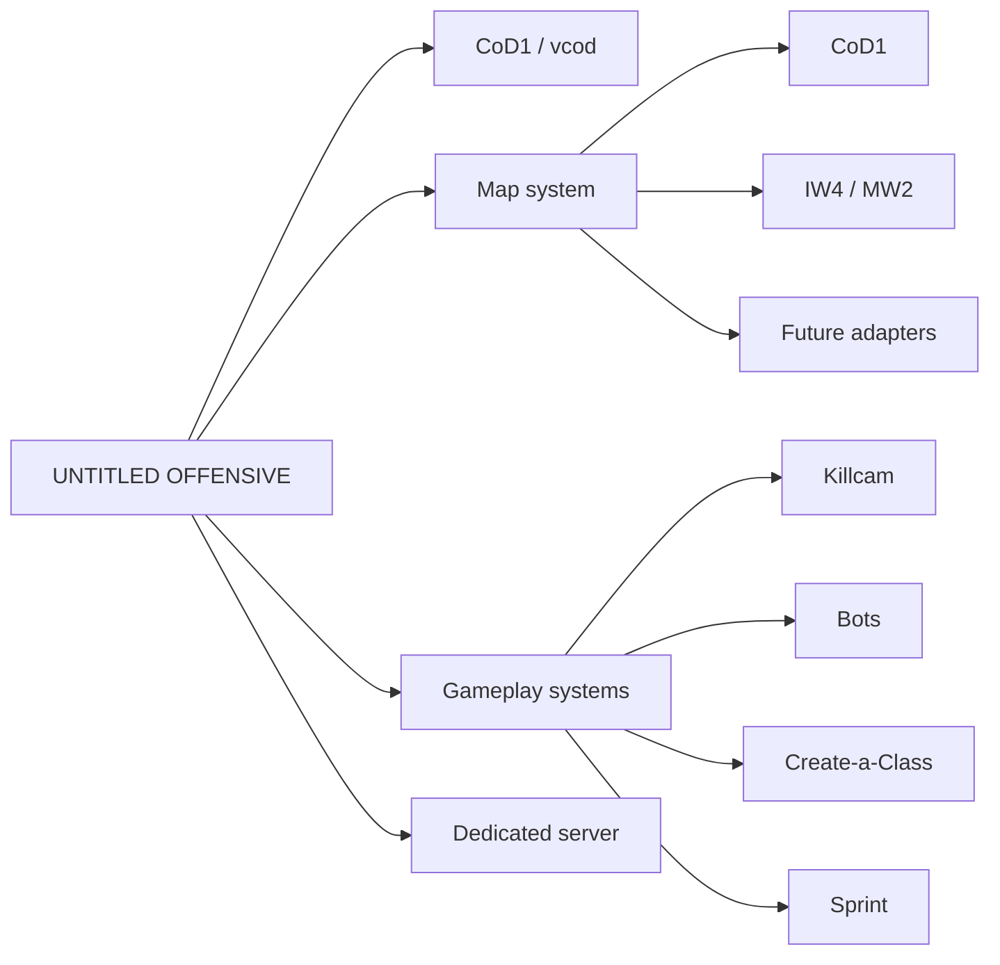

<div align="center">

# UNTITLED OFFENSIVE

### A classic Call of Duty sandbox built on the CoD1 engine through vcod.

<p align="center">
  
  
  
  
</p>

<p align="center">
  
  
  
</p>

**UNTITLED OFFENSIVE takes the Call of Duty 1 foundation and turns it into a sandbox for classic Call of Duty gameplay, maps and systems.**

Built on [vcod](https://github.com/janost/vcod) by janost.

</div>

---

## What works

| Area | Feature | Status |
| --- | --- | --- |
| Core | Call of Duty 1 multiplayer | Working |
| Maps | Stock CoD1 maps | Working |
| Maps | Community CoD1 maps | Working |
| Gameplay | Killcam | Working |
| Gameplay | Create-a-Class | Working |
| Gameplay | Sprint with first-person viewmodel presentation | Working |
| AI | Bots | Working |
| Server | Dedicated server | Working |
| Server | Authenticated RCON | Working |
| IW4 | Modern Warfare 2 map loading | Experimental |
| IW4 | Rust | Experimental |
| Frontend | Menu and playlist system | In development |
| Engines | Source 1 adapter | Planned |

---

## The idea

UNTITLED OFFENSIVE started as an experiment with vcod and gradually grew into something bigger.

CoD1 stays at the centre of the project. The aim is to keep the feel and foundation of early Call of Duty while making the engine flexible enough to mix in selected systems and locally loaded content from other classic Call of Duty engine generations.

Content from other games is loaded from installations the player already owns. Proprietary game assets are not redistributed with the project.



---

## Current status

UNTITLED OFFENSIVE is alpha software and is actively being developed.

The CoD1 multiplayer foundation is working. IW4 support is experimental, with Rust used as the current proving ground for native MW2 map loading. Frontend and lifecycle work is still in progress.

See [ROADMAP.md](ROADMAP.md) for the current development plan.

---

## Requirements

- Windows x64
- Rust 1.90+ for building from source
- A legitimate Call of Duty (2003) installation with `main/pak0.pk3`
- A legitimate Modern Warfare 2 (2009) installation for experimental IW4 content

---

## Building

```powershell
cargo build --release
```

This builds the `vcod` client and `vcod-server` binaries.

## Running

```powershell
# Run a local match with a retail CoD1 install
.\run-dev-match.bat

# Or run the server and client manually
.\target\release\vcod-server.exe mp_carentan --bots 4 --gametype dm
.\target\release\vcod.exe --connect 127.0.0.1:28960
```

See [FRIENDS-ALPHA.md](FRIENDS-ALPHA.md) for the current package layout and setup notes.

---

## Development

UNTITLED OFFENSIVE is developed with a mixture of manual work and AI-assisted development.

AI tools are used for codebase inspection, research, debugging, implementation, testing and documentation. The direction of the project is decided manually, and changes are checked against the actual project and game before they are treated as working.

Visual and gameplay changes also get human testing because passing an automated test does not necessarily mean something looks or plays correctly.

Reverse engineering and compatibility work is based on evidence from the original games, existing research, runtime behaviour and the code rather than made-up assumptions.

---

## Credits

UNTITLED OFFENSIVE is built on [vcod](https://github.com/janost/vcod) by janost.

vcod is a from-scratch Rust reimplementation of parts of Call of Duty (2003) patch 1.1. A large part of the CoD1 engine, rendering, networking, scripting, movement and reverse-engineering groundwork used by this project comes from vcod.

Additional credits and lineage are documented in the [vcod repository](https://github.com/janost/vcod) and the original project's [NOTICE](NOTICE) file.

---

## Legal

UNTITLED OFFENSIVE is not affiliated with or endorsed by Activision, Infinity Ward, Treyarch or Microsoft.

No proprietary Call of Duty assets are distributed by this repository. Users must provide game content from legitimately owned installations.

Licensed under GPL-3.0-or-later. See [LICENSE](LICENSE).

---

<div align="center">

### CoD1 at the centre. Everything else is an experiment.

</div>
